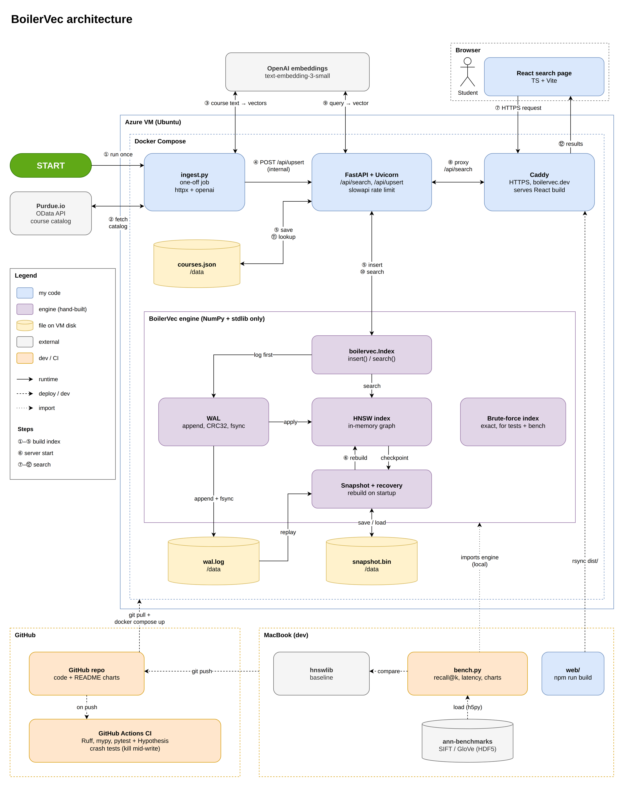

# BoilerVec

A vector database built from scratch in Python, powering a semantic course search for Purdue students.

**Status.** In progress. The MVP target date is November 24, 2026. Until then, everything below describes planned work.

## Project goal

Purdue's course search matches keywords and course numbers, so a class that fits what a student wants can stay hidden when its title uses different words. Searching by meaning needs a vector database that finds the closest matches quickly and keeps its data safe through crashes.

BoilerVec is a vector database written from scratch in Python, using HNSW graph search to find nearest neighbors and a write-ahead log to recover from crashes. Its recall and speed will be benchmarked against hnswlib and brute-force search. It will power a live course search where Purdue students describe what they want in plain words and get matching courses.

The engine depends only on NumPy and the Python standard library, so all of its search and storage logic is written by hand.

## MVP scope

### Engine

- Brute-force index as ground truth
- HNSW insert and search
- Neighbor-selection heuristic
- Cosine and L2 distance

### Persistence

- Binary snapshot format
- Write-ahead log with crash recovery

### Testing and benchmarks

- Recall@k benchmark harness
- Benchmarks against hnswlib
- Fault-injection crash tests
- Property tests comparing HNSW with brute-force search

### App and deployment

- Purdue course data ingestion
- Upsert and query API endpoints
- React course search page
- Live deployment with HTTPS
- README with benchmark charts

## Future plans

These are planned for after the MVP.

- Metadata filters, such as showing only 300-level CS courses
- Deletes using tombstones
- Vector compression through quantization
- A pip-installable package
- A compiled hot path with Numba or C
- Benchmarks at 1 million vectors
- Write-ahead log compaction
- Concurrent reads during writes
- Automatic catalog refresh each semester

## Architecture



Start at the green START marker and follow the numbered steps. The ingest job builds the index first, and the API then answers searches through Caddy. On every restart, the engine rebuilds its index from the latest snapshot and replays the write-ahead log.

## Tech stack

| Category | Tools |
| --- | --- |
| Languages | Python, TypeScript |
| Libraries | NumPy, Python standard library (heapq, struct, zlib, os), FastAPI, Uvicorn, httpx, openai, slowapi |
| Frontend | React, Vite, npm, CSS |
| Testing and benchmarks | pytest, Hypothesis, hnswlib, h5py, ann-benchmarks, matplotlib |
| Commands | curl, jq, ssh, rsync |
| Data storage | JSON file, BoilerVec snapshot and write-ahead log files |
| Data sources | Purdue.io OData API, OpenAI Embeddings API |
| Tooling | uv, Git, GitHub Actions, Ruff, mypy |
| Deployment | Docker Compose, Caddy, Azure Ubuntu VM, Name.com domain |

## Folder structure

The engine and the API live in separate packages under `src`, which keeps the engine free of web dependencies.

```
boilervec/
├── .github/
│   └── workflows/
├── bench/
├── data/
├── deploy/
├── docs/
│   └── charts/
├── src/
│   ├── app/
│   └── boilervec/
├── tests/
│   ├── app/
│   └── boilervec/
└── web/
    ├── public/
    └── src/
```

## Milestones and status

Each milestone maps to roughly one commit. Boxes get checked as the work lands.

- [ ] Set up the Git repo with uv and GitHub Actions CI
- [ ] Build the brute-force index and recall@k harness
- [ ] Pull Purdue courses into JSON and embed them with OpenAI
- [ ] Serve brute-force course search through FastAPI and a React page
- [ ] Deploy to Azure behind Caddy at the custom domain
- [ ] Implement HNSW insert and search
- [ ] Add the neighbor-selection heuristic and benchmark against hnswlib
- [ ] Save and load binary snapshots
- [ ] Add the write-ahead log with crash-recovery tests
- [ ] Switch the live site to HNSW and publish benchmark results

## Author

Built by Sevan Bland. Find me on LinkedIn at www.linkedin.com/in/sevbland.
